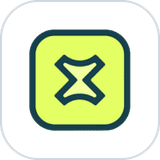
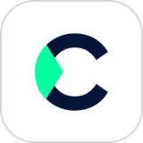

<h1 align="center">Helping Businesses To Grow Through Intelligent Software</h1>

<b>CURRENTLY</b>

<table align="center">
  <tr>
    <td align="center" width="25%">
       
      <a href="https://codvise.com"><b>CodVise</b></a> 
      CTO & Founder
    </td>
    <td align="center" width="25%">
       
      <a href="https://saiyaara.pk"><b>Saiyaara Travels</b></a> 
      Founder & CEO
    </td>
    <td align="center" width="25%">
       
      <a href="https://cmpautomate.com"><b>CMPAutomate</b></a> 
      Lead Software Engineer
    </td>
    <td align="center" width="25%">
       
      <a href="https://autoplace.al"><b>AutoPlace</b></a> 
      Senior Software Engineer
    </td>
  </tr>
</table>

  Full-stack across server, web and mobile, with most of my time spent on 
  <b>payments</b>, <b>accounting logic</b>, <b>search</b> and the <b>integrations</b> that connect systems.

  <a href="#featured-work"><kbd>&nbsp;Featured work&nbsp;</kbd></a>&nbsp;
  <a href="#experience"><kbd>&nbsp;Experience&nbsp;</kbd></a>&nbsp;
  <a href="#tech-stack"><kbd>&nbsp;Tech stack&nbsp;</kbd></a>&nbsp;
  <a href="#what-i-focus-on"><kbd>&nbsp;Focus&nbsp;</kbd></a>&nbsp;
  <a href="#get-in-touch"><kbd>&nbsp;Get in touch&nbsp;</kbd></a>

 

## Featured work

Most of my product and client code is in private repositories, so the cards link to the live product where there is one.

<table>
  <tr>
    <td width="50%" valign="top">
      <b>MOBILE APP · iOS & ANDROID</b>
      <h2>Itr</h2>
      

        
        
      

      
Ad-free Qur'an recitation player built on the Quran Foundation API: 13 reciters, every surah, translations and offline listening.

      <ul>
        <li>Ayah-by-ayah sync highlights the verse being recited, with tap-to-jump and verse looping</li>
        <li>Bundled catalogue for instant offline search, background audio, encrypted storage</li>
      </ul>
      
      
      
      
    </td>
    <td width="50%" valign="top">
      <b>MARKETPLACE · API, WEB, iOS & ANDROID</b>
      <h2>AutoPlace</h2>
      

        
        
      

      
Car classifieds marketplace for the Albanian market with dealer showrooms, subscriptions, listing promotion and real-time chat.

      <ul>
        <li>Weighted listing ranking with anti-gaming penalties; full-text search over 41k vehicle records</li>
        <li>Stripe plus a local card gateway, Google & Apple sign-in, push notifications</li>
      </ul>
      
      
      
      
      
    </td>
  </tr>
  <tr>
    <td width="50%" valign="top">
      <b>MARKETPLACE · iOS & ANDROID</b>
      <h2>DirtConnect</h2>
      

        
        
        
      

      
Construction-materials marketplace that connects contractors, site managers and suppliers in Australia to exchange fill and excess dirt on a live map.

      <ul>
        <li>Map of import, export and commercial sites with radius search (5–50 km) and material filters</li>
        <li>Personal and business accounts with teams, photo listings, push alerts for nearby sites</li>
      </ul>
      
      
      
    </td>
    <td width="50%" valign="top">
      <b>BOOKING PLATFORM · WEB & BACK OFFICE</b>
      <h2>Saiyaara Travels</h2>
      

        
        
      

      
Tour booking site for a Pakistani travel company, backed by a system that runs tours, bookings, coach seat maps, payments, refunds, vendors and reports.

      <ul>
        <li>Concurrency-safe seat holds and refund locks</li>
        <li>Generated PDF itineraries and Excel report exports</li>
      </ul>
      
      
      
      
    </td>
  </tr>
  <tr>
    <td width="50%" valign="top">
      <b>ERP · FINANCE & OPERATIONS</b>
      <h2>Trading-company ERP</h2>
      

        
        
      

      
Buy-to-order ERP covering quotes, purchasing, invoices and credit notes, banking, payroll and a double-entry general ledger.

      <ul>
        <li>Multi-currency journals with realised FX gain/loss, reversals and period close</li>
        <li>Bank reconciliation rules, Peppol UBL e-invoicing, signed webhook integrations</li>
      </ul>
      
      
      
      
    </td>
    <td width="50%" valign="top">
      <b>B2B E-COMMERCE · WEB</b>
      <h2>CMPAutomate</h2>
      

        
        
      

      
SEO-first storefront for ~70k industrial-automation parts with RFQ, repair and surplus-buying flows, plus an Arabic storefront.

      <ul>
        <li>Meilisearch part search with a shared part-number normaliser</li>
        <li>Redis/BullMQ workers for imports, images and SEO audits</li>
      </ul>
      
      
      
      
    </td>
  </tr>
</table>

### More projects

| Project | What it is |
| --- | --- |
| [**SalatTrails**](https://github.com/usmanisofficial/salattrails) | Open-source Expo app for logging the mosques you've prayed at on a map, following friends and checking prayer times |
| **BoardVise** | AI question bank and test-paper generator that rejects any AI question whose answer isn't quoted verbatim from the source chapter |
| **School management platform** | Multi-tenant NestJS + Next.js system with PostgreSQL row-level security, background jobs and MFA (in development) |
| **Stripe wallet gateway** | WordPress plugin adding Apple Pay and Google Pay to WP Travel Engine, including deposit payments |

## Experience

| Role | Company | Period |
| --- | --- | --- |
| **CTO & Founder** | [CodVise](https://codvise.com) | Oct 2025 – Present |
| **Founder & CEO** | [Saiyaara Travels](https://saiyaara.pk) | Apr 2026 – Present |
| **Lead Software Engineer** | [CMPAutomate](https://cmpautomate.com) | Present |
| **Senior Software Engineer** | [AutoPlace](https://autoplace.al) | Present |
| **Senior Software Engineer** | [DirtConnect](https://apps.apple.com/au/app/dirtconnect/id6757248872) · Australia | Previously |
| **Software Engineer** | Coduko | Nov 2023 – Oct 2025 |

Education: <a href="https://www.nu.edu.pk/">National University of Computer and Emerging Sciences (FAST-NUCES)</a>

## Tech stack

  

Also: React Native & Expo · Meilisearch · BullMQ · Stripe · Socket.IO · Sentry · Vitest · Playwright

## What I focus on

<table>
  <tr>
    <td width="50%" valign="top">
      <h4>&nbsp; Correct money logic</h4>
      
Double-entry ledgers, multi-currency settlement, bank reconciliation and payment flows that stay consistent when things go wrong.

      <b>SEEN IN</b> &nbsp;Trading-company ERP · AutoPlace
    </td>
    <td width="50%" valign="top">
      <h4>&nbsp; SaaS architecture</h4>
      
Multi-tenant data isolation, role-based access, background workers and schemas designed to hold up as products grow.

      <b>SEEN IN</b> &nbsp;School management platform · CMPAutomate
    </td>
  </tr>
  <tr>
    <td width="50%" valign="top">
      <h4>&nbsp; Integrations</h4>
      
Payment gateways, bank statement imports, e-invoicing, social sign-in and signed webhooks between systems.

      <b>SEEN IN</b> &nbsp;AutoPlace · Trading-company ERP · DirtConnect
    </td>
    <td width="50%" valign="top">
      <h4>&nbsp; Mobile apps</h4>
      
Cross-platform iOS and Android apps with offline-first data, maps, background audio and over-the-air updates.

      <b>SEEN IN</b> &nbsp;Itr · DirtConnect · SalatTrails
    </td>
  </tr>
</table>

## Get in touch

Building a product, need an engineering lead, or want to talk shop? I'd like to hear from you.

<table align="center">
  <tr>
    <td align="center" width="33%">
       
      <b>CODVISE</b> 
      <a href="mailto:usman@codvise.com">usman@codvise.com</a>
    </td>
    <td align="center" width="33%">
       
      <b>SAIYAARA TRAVELS</b> 
      <a href="mailto:usman@saiyaara.pk">usman@saiyaara.pk</a>
    </td>
    <td align="center" width="33%">
       
      <b>CMPAUTOMATE</b> 
      <a href="mailto:usman@cmpautomate.com">usman@cmpautomate.com</a>
    </td>
  </tr>
  <tr>
    <td align="center" width="33%">
       
      <b>WEBSITE</b> 
      <a href="https://codvise.com">codvise.com</a>
    </td>
    <td align="center" width="33%">
       
      <b>LINKEDIN</b> 
      <a href="https://linkedin.com/in/usmanisofficial">in/usmanisofficial</a>
    </td>
    <td align="center" width="33%">
       
      <b>X</b> 
      <a href="https://x.com/usmanisofficial">@usmanisofficial</a>
    </td>
  </tr>
</table>

Based in Lahore, Pakistan · working with teams in Australia, the UAE and Albania

